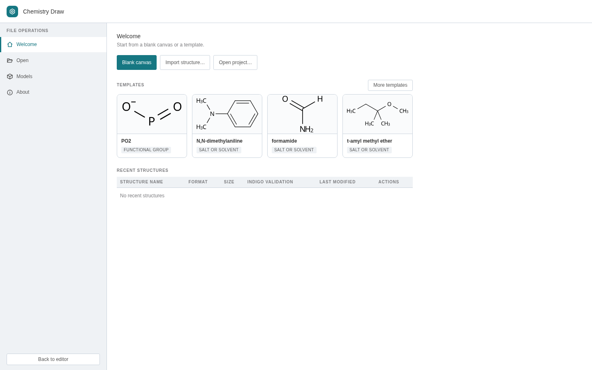
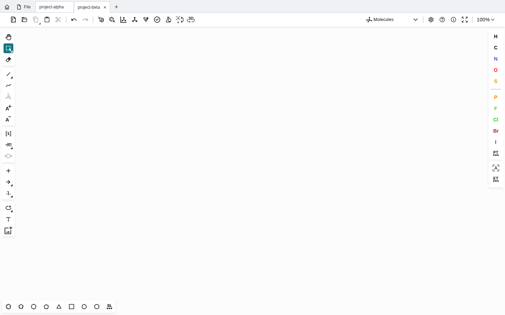

# Chemistry Draw

  

  A fast, offline desktop editor for drawing chemical structures, reactions, and macromolecules.

  <a href="https://github.com/spalax-dev/chemistry_draw/releases">Download</a> ·
  <a href="CONTRIBUTING.md">Contributing</a> ·
  <a href="LICENSE">License</a>

> **Community project.** Chemistry Draw is an unofficial desktop packaging of
> [Ketcher](https://github.com/epam/ketcher) (© EPAM Systems, Apache 2.0). It
> is not affiliated with or supported by EPAM.

## Features

- **Full Ketcher editor** — draw molecules, reactions, and macromolecules.
- **Native performance** — uses a Rust sidecar with native
  [Indigo](https://github.com/epam/Indigo) for cheminformatics (instead of
  WebAssembly).
- **Image-to-structure (Only Linux)** — basic structure recognition powered by EPAM
  Imago v2.
- **Documents are `.ket`** — a **File** menu at the left of the tab strip owns
  Open (`.ket`), Import (Molfile, SMILES, InChI, SDF, RXN), Save, Save As and
  Export, plus a recent-documents list; **Export** is the way to Molfile, SMILES,
  InChI, PNG and SVG.
- **Backstage** — every launch opens on Welcome with blank canvas, import/open,
  a random 2/4/6/8-card subset of Ketcher's real Structure Library with
  Ketcher-rendered previews, **More templates** for the full library and a
  **Back to editor** action for the active tab; the rail has four sections —
  Welcome, Open, Models and About — with a reserved Models entry (empty for
  now) and a **Back to editor** button at the bottom, and a home button in the
  tab strip returns to it. Settings are Ketcher's own toolbar dialog, not a
  backstage section. Welcome also shows a compact
  **Recent structures** table with each document's real size and last-modified
  time, the Indigo validation result and a cached Indigo-rendered thumbnail.
- **Document tabs** — keep several `.ket` documents open in one window; every
  tab keeps its own unsaved content and the set is restored on relaunch.
- **Offline-first** — runs entirely on your machine.

## Screenshots

_Backstage: welcome, templates and recent structures._

_The editor with two project tabs._

## Download

Get the latest version from the
[**Releases** page](https://github.com/spalax-dev/chemistry_draw/releases).

| Platform             | Download      | Notes                                        |
| -------------------- | ------------- | -------------------------------------------- |
| Debian / Ubuntu      | `.deb`        | x86_64, glibc ≥ 2.36                         |
| Fedora / RHEL        | `.rpm`        | x86_64, glibc ≥ 2.36                         |
| Other Linux          | `.AppImage`   | x86_64, glibc ≥ 2.36                         |
| Windows 10/11 x86_64 | `.exe` (NSIS) | Requires the Microsoft Edge WebView2 runtime |

**Linux notes:** supported on distros with glibc ≥ 2.36 (e.g. Debian 12+,
Ubuntu 24.04+, Arch). To run an AppImage directly you may need FUSE; otherwise
use `APPIMAGE_EXTRACT_AND_RUN=1`.

**Windows notes:** image recognition (Imago/OpenCV) is not included in Windows
builds. The app requires the Microsoft Edge WebView2 runtime, which is normally
included with Windows 10/11.

## Contributing

Contributions are welcome — bug reports, ideas, docs, and code.

- Read [docs/CONTRIBUTING.md](CONTRIBUTING.md) for how to get involved.
- Building from source or working on the codebase? See
  [docs/DEVELOPMENT.md](docs/DEVELOPMENT.md).

## License

Apache 2.0 — see [LICENSE](LICENSE) and [NOTICE](NOTICE).
