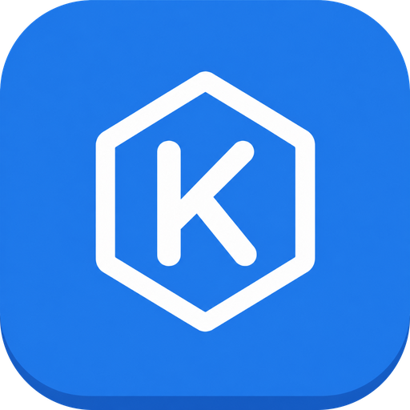

# Chemistry Draw

  

  A fast, offline desktop editor for drawing chemical structures, reactions, and macromolecules.

  <a href="https://github.com/spalax-dev/chemistry_draw/releases">Download</a> ·
  <a href="CONTRIBUTING.md">Contributing</a> ·
  <a href="LICENSE">License</a>

> **Community project.** Chemistry Draw is an unofficial desktop packaging of
> [Ketcher](https://github.com/epam/ketcher) (© EPAM Systems, Apache 2.0). It
> is not affiliated with or supported by EPAM.

## Features

- **Full Ketcher editor** — draw molecules, reactions, and macromolecules.
- **Native performance** — uses a Rust sidecar with native
  [Indigo](https://github.com/epam/Indigo) for cheminformatics (instead of
  WebAssembly).
- **Recognize Molecule** — convert a PNG, JPEG or WebP image into an editable
  structure with the local ONNX classifier and OCSR model. No cloud service.
- **First-run model setup** — the recognition models (~309 MiB) are not bundled;
  while setup needs attention (models missing, an update, a repair, an
  active/cancelled/failed run, or a recognition failure that reports the models
  unavailable) a **Models** toolbar entry opens a dialog that downloads,
  resumes, verifies or repairs them. The attention override lasts until Verify
  reports the files good or a completed download reads healthy — accepting a
  request is not proof, and a new recognition failure invalidates an earlier
  run's pending proof — and the dialog shows a short Verify note while it is
  armed on a ready, verify-capable dialog (not during a run). The download is
  opt-in and images never leave your machine.
- **Documents are `.ket`** — Save (Ctrl+S) writes the Ketcher `.ket` format to
  the file you chose (the native Save dialog appears the first time); **Export**
  is the way to Molfile, SMILES, InChI, PNG and SVG. Save, New and Export live
  in Ketcher's own toolbar, next to the conditional Models entry.
- **Offline-first** — runs entirely on your machine.

## Download

Get the latest version from the
[**Releases** page](https://github.com/spalax-dev/chemistry_draw/releases).

| Platform             | Download      | Notes                                        |
| -------------------- | ------------- | -------------------------------------------- |
| Debian / Ubuntu      | `.deb`        | x86_64, glibc ≥ 2.36                         |
| Fedora / RHEL        | `.rpm`        | x86_64, glibc ≥ 2.36                         |
| Other Linux          | `.AppImage`   | x86_64, glibc ≥ 2.36                         |
| Windows 10/11 x86_64 | `.exe` (NSIS) | Requires the Microsoft Edge WebView2 runtime |

**Linux notes:** supported on distros with glibc ≥ 2.36 (e.g. Debian 12+,
Ubuntu 24.04+, Arch). To run an AppImage directly you may need FUSE; otherwise
use `APPIMAGE_EXTRACT_AND_RUN=1`.

**Windows notes:** the app requires the Microsoft Edge WebView2 runtime, which
is normally included with Windows 10/11.

## Contributing

Contributions are welcome — bug reports, ideas, docs, and code.

- Read [docs/CONTRIBUTING.md](CONTRIBUTING.md) for how to get involved.
- Building from source or working on the codebase? See
  [docs/DEVELOPMENT.md](docs/DEVELOPMENT.md).

## License

Apache 2.0 — see [LICENSE](LICENSE) and [NOTICE](NOTICE).
